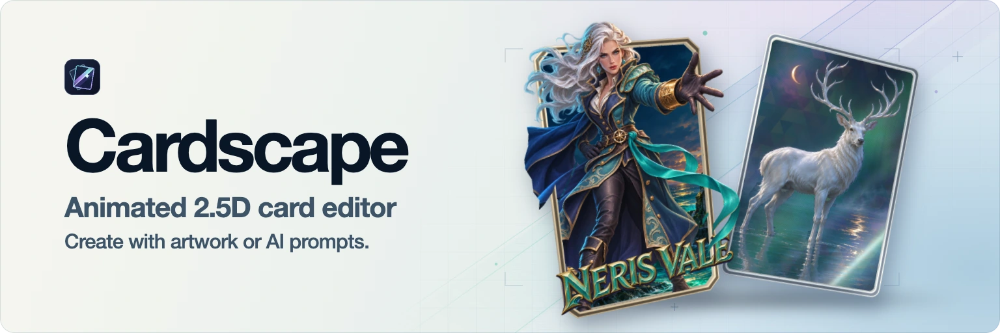
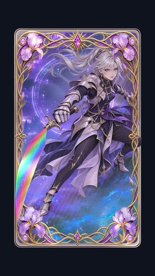
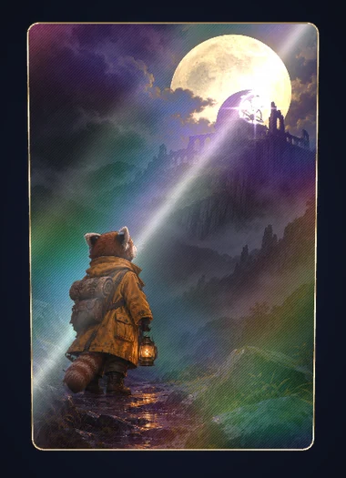
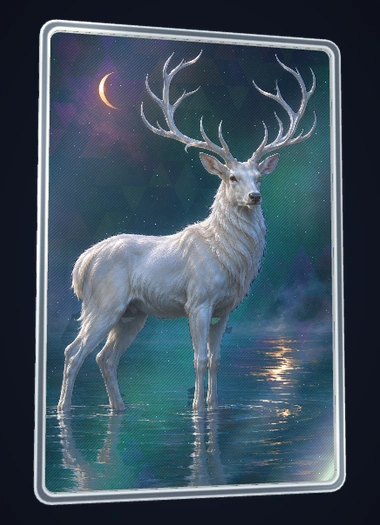
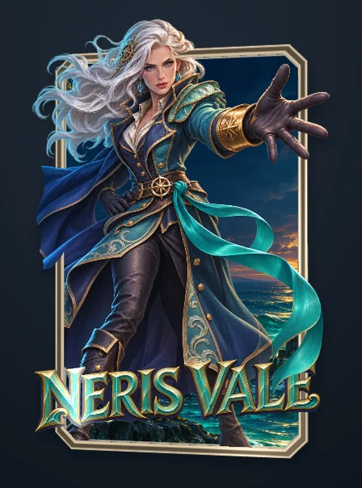
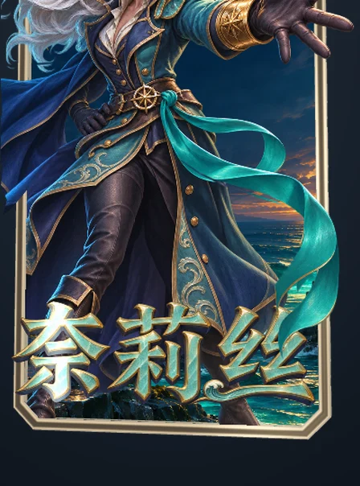
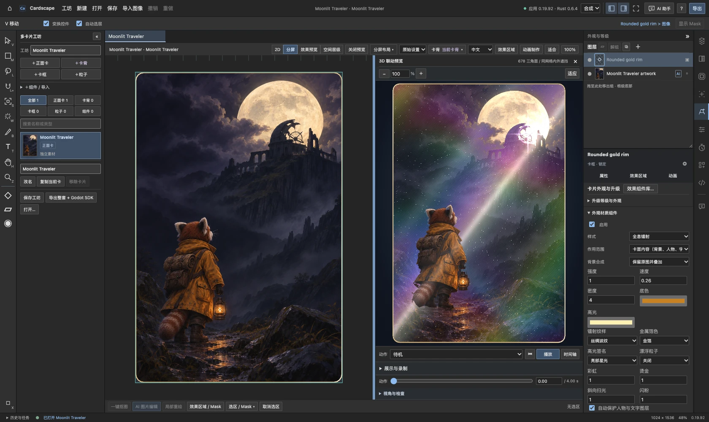

<p align="center">
  
</p>

# Cardscape

**A desktop editor for turning prompts and illustrations into animated 2.5D cards.**

Build a card from a single image or assemble separate layers for the character, scenery, frame, and back. Add parallax, break the frame with foreground art, and make foil catch the light as the card tilts. Save the editable project, then export a loop for sharing, a WebGL player for the browser, or a Godot scene for a game.

[Download](https://github.com/RainLib/Cardscape/releases) · [Examples](#examples) · [Quick start](#quick-start) · [Editor guide](editor/README.md) · [Godot SDK](sdk/godot/README.md) · [Contributing](#contributing)

## Examples

### Stormglass Oath



On the editor home screen, choose **Demo Projects → Stormglass Oath** to open an editable copy and watch the four-second loop. The knight's gauntlet and blade tip sit at different depths. The foil shifts as the card tilts, and a thunder slash fires as the astral dial lights up. [Workshop file](editor/examples/production-card/stormglass-oath/stormglass-oath.cardworkshop) · [Depth maps and recording settings](editor/examples/production-card/stormglass-oath/README.md)

### Angle-responsive foil

<table>
  <tr>
    <td align="center"></td>
    <td align="center"></td>
  </tr>
  <tr>
    <td><strong>Moonlit Traveler</strong><br>Silk-pattern gold foil, rainbow reflection, and glitter move with the tilt. A painted mask protects the traveler's coat color while the white highlight crosses it.<br><a href="editor/examples/production-card/moonlit-traveler/moonlit-traveler.cardworkshop">Open the workshop</a></td>
    <td><strong>Moonveil Stag</strong><br>Aurora, crystal, and frost patterns shift at the same tilt angles as Moonlit Traveler. The diagonal white sweep crosses the antlers, coat, and lake.<br><a href="editor/examples/production-card/moonveil-stag/moonveil-stag.cardworkshop">Open the workshop</a></td>
  </tr>
</table>

### 3D character cards

<table>
  <tr>
    <td align="center"></td>
    <td align="center"></td>
  </tr>
  <tr>
    <td><strong>Neris Vale</strong><br>The hand and cuff project through the brass rim with a shallow depth offset at the sleeve. The cape and loose hair move around fixed roots.</td>
    <td><strong>Local motion and light</strong><br>The sash flutters over the illustrated wordmark. Light travels along the brass engravings while the card holds its angle. Switch between the English and Simplified Chinese wordmarks in the editor.</td>
  </tr>
</table>

Apply **Neris Vale** from **Appearance → Effect Library → Character Effects** to use these effects on your own artwork. Mark the regions for your portrait, choose which layer crosses the wordmark, and tune the sash, hair, cape, and glow independently. The character effects can be combined with foil, frames, and particles. [Preset walkthrough](editor/README.md#apply-the-neris-vale-character-preset)

Both loops were captured from Cardscape's WebGL player. Open the workshop from Home to explore the finished card. [Neris Vale workshop](editor/examples/production-card/neris-vale/neris-vale.cardworkshop) · [Artwork notes](editor/examples/production-card/neris-vale/generation.md)

## The workspace



Arrange the source artwork and paint masks in the 2D canvas, then check depth and lighting in the live WebGL preview. The editor guide walks through marking a subject, stacking foil patterns, scrubbing an action, and exporting the finished card. [Editor guide](editor/README.md)

## What you can build

- **AI-driven card generation.** Describe a card in the AI Assistant. A configured agent can generate character art, scenery, a card back, and wordmarks, then assemble them into an editable card with layers, masks, and effects. [AI workflow](editor/README.md#generate-a-card-with-ai)
- **Collectible finishes.** Combine holographic textures, metal tones, directional reflections, glitter, and particles. Use a subject mask to keep the base artwork's hues.
- **Layered cards.** Arrange image and text layers in depth, draw custom frame outlines and windows, and give the card a back. Preview occlusion and the parts that cross the frame.
- **Animated characters.** Edit bones, meshes, weights, and IK. Use the timeline to keyframe poses and place particles and sound on actions. Reuse frames, materials, and other components across a workshop.
- **Shareable cards and game assets.** Record a GIF or MP4 or export PNGs, a portable WebGL player, and a Godot SDK project with its textures, masks, and animation data.

## Quick start

Download the Windows x64 installer (`.exe`) or the macOS disk image (`.dmg`). Choose `arm64` for Apple Silicon or `x64` for an Intel Mac. Each installer includes Electron and the Rust worker. [GitHub Releases](https://github.com/RainLib/Cardscape/releases)

### Build from source

Install Node.js 22.18 or newer, npm, Make, and a stable Rust toolchain with Rust 2024 edition support.

```sh
git clone https://github.com/RainLib/Cardscape.git
cd Cardscape
make setup
make start
```

For desktop development with hot reload, run `make dev`. Run `make web` for the local browser editor at `http://127.0.0.1:8770/index.html`. Use `make web PORT=8771` to change the port.

The editor opens in English by default. Use **Interface Language** in the top bar to switch to Simplified Chinese. [Language settings](editor/README.md#interface-language)

The editor includes the default art assets. Local smart selection and background removal are optional and can be installed separately. [Setup and development commands](editor/README.md#development)

## Repository layout

| Path                                   | Purpose                                                                            |
| -------------------------------------- | ---------------------------------------------------------------------------------- |
| [`editor/renderer/`](editor/renderer/) | TypeScript editing workspace, WebGL renderer, and browser player                   |
| [`editor/electron/`](editor/electron/) | Desktop process, file access, and export services                                  |
| [`editor/native/`](editor/native/)     | Rust worker for image processing, masks, and geometry                              |
| [`editor/examples/`](editor/examples/) | Editable sample workshops and their source assets                                  |
| [`sdk/godot/`](sdk/godot/)             | Godot runtime and integration guide                                                |
| [`docs/branding/`](docs/branding/)     | Repository artwork and scalable [Cardscape mark](docs/branding/cardscape-mark.svg) |

Cardscape uses Electron, TypeScript, WebGL, and Rust. See the editor architecture and capability notes for development details and validation coverage. [Architecture](editor/docs/typescript-architecture.md) · [Capability audit](editor/CAPABILITY_AUDIT.md)

## Contributing

Report a bug, suggest a feature, or contribute documentation, a sample workshop, or a code change. The contribution guide covers local setup, validation, and how to open a pull request against `main`. [GitHub Issues](https://github.com/RainLib/Cardscape/issues) · [Contribution guide](CONTRIBUTING.md)
