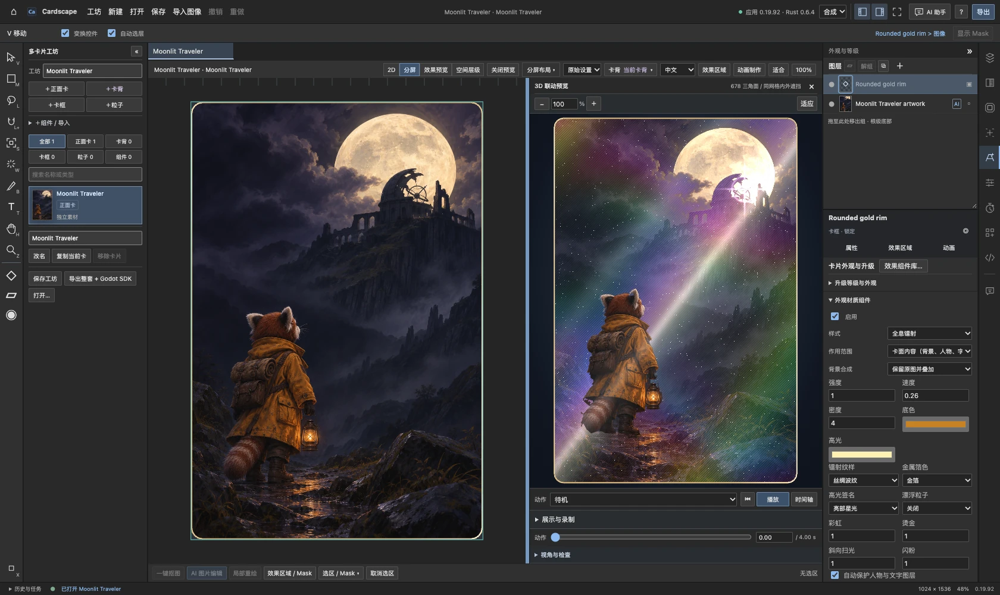
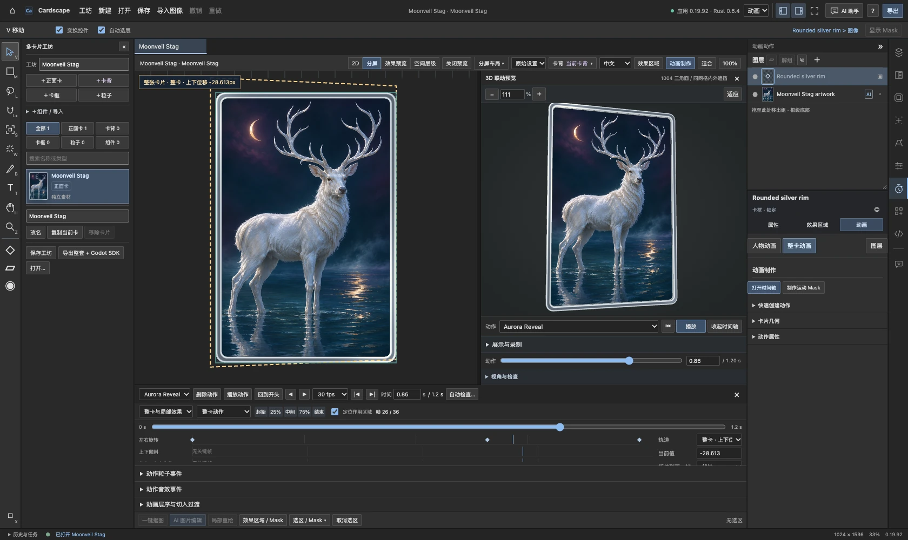

# Cardscape editor

The Cardscape desktop workspace combines an editable 2D source with a live WebGL card. Use it to compose a card face, author depth and motion, and package the result for the web or Godot. [Project overview](../README.md)

## Run the editor

Install Node.js 22.18 or newer and a stable Rust toolchain with Rust 2024 edition support before running these commands from the `editor` directory.

```sh
npm ci
npm run native:build
npm start
```

`npm start` builds the Electron app before launching it. The default artwork and icons ship with the source tree. On macOS, `启动卡牌工坊.command` is also available after dependencies are installed.

On the home screen, open **Demo Projects** (示例工程) to play the four-second actions and explore the original artwork, relief meshes, scenery, and effects in an editable copy. [Animated previews](../README.md#examples) · [Action and effect index](../README.md#demo-animation-effects) · [Workshops and depth maps](examples/production-card/collectible-styles.md)

## Package and release the desktop app

Run `npm run package:desktop -- --win --x64` on Windows. On macOS, run `npm run package:desktop -- --mac --arm64` on Apple Silicon or use `--x64` on an Intel Mac. Install the dependencies with `npm ci` first. The packages land in `editor/release/`.

For a release, set the version in `editor/package.json` and its lockfile, then commit the change. Run these commands from the repository root to tag that commit.

```sh
version=$(node -p "require('./editor/package.json').version")
git tag -a "v$version" -m "Cardscape v$version"
git push origin "v$version"
```

The **Desktop release** workflow runs when you push a new tag. It verifies all three packaged apps before publishing the Windows x64 `.exe` and both macOS `.dmg` files to that tag's GitHub Release. The macOS builds use ad hoc signatures, and the Windows installer is unsigned. [Desktop release workflow](../.github/workflows/desktop-release.yml)

Installed apps store preferences and recovery data in the user's application data directory. Set `ATELIER_RUNTIME` before launch to choose another location.

## Interface language

The editor opens in English by default. Choose **English** or **简体中文** in **Interface Language** in the top bar on Home or in the workspace. In the desktop app, you can also use **View → Interface Language**. The interface updates immediately and remembers your choice for the next launch.

Use **Card Language** in the preview toolbar to switch between the card's saved wordmark variants. The interface language is a separate preference.

## Find your way around



| Workspace control                   | What it does                                                                                                              |
| ----------------------------------- | ------------------------------------------------------------------------------------------------------------------------- |
| **2D**                              | Arrange source images and text, work with selections, and paint masks.                                                    |
| **Split view** (分屏)               | Keep the 2D canvas and 3D preview visible together. Change the split direction or drag the divider to resize either pane. |
| **Effect preview** (效果预览)       | Rotate, zoom, and flip the finished card. Pause the preview to inspect a particular angle.                                |
| **Spatial layers** (空间层级)       | Inspect Z depth, draw order, frame clipping, and foreground pieces that break the frame.                                  |
| **Appearance** (外观与等级)         | Apply material, border, and particle presets. Edit the foil layers and how they respond to light.                         |
| **Animation timeline** (动画时间轴) | Scrub an action, edit its tracks, and synchronize particles and audio.                                                    |

## Generate a card with AI

1. Open a workshop in the desktop editor and open **AI Assistant** (AI 助手). Choose a signed-in Codex CLI or a compatible external agent that supports chat and image tasks. The agent needs access to an image-generation tool to create new artwork.
2. Click **Full Production** (完整制作) and add your brief to the prompt. Enable **Continuous Production** (连续制作) in **AI Settings → Preferences** (AI 设置 → 偏好) to let the agent advance through artwork generation, layer assembly, masking, and effects.
3. Review the artwork and check the card in the live preview. Save the workshop to keep the layers, masks, wordmarks, and effects editable.

For example, ask for a moonlit sea cartographer with a fluttering silk sash, a brass wordmark, and a compass-rose card back. [Card Atelier skill](skills/card-atelier/SKILL.md) · [Agent setup and image tasks](AGENT_PROTOCOL.md)

## Make a holographic card

1. From Home, choose **Open project** (打开工程) and open the [Moonlit Traveler workshop](examples/production-card/moonlit-traveler/moonlit-traveler.cardworkshop). For your own art, start a card and use **Import image** (导入图像) to add a background.
2. Open **Appearance → Effect Library → Holographic Foil** (效果组件库 → 镭射). Click a recipe to preview it, then apply it to the card. In the material inspector, **Match Artwork** (自动匹配原图) analyzes the artwork and selects a pattern, metal tone, and highlight position.
3. Choose **Mark Subject** (标注主体). Paint white where the color should be protected and black where the material should show through, or write a selection to the mask. The white sweep can still light the marked subject.
4. Under **Layer Patterns** (叠加纹样), pick a base material and add up to three patterns with independent strengths. Adjust the rainbow, foil, glare, and glitter controls while dragging the live preview. The card face can also be cropped and mounted in five layouts.
5. Open **Showcase & Capture** (展示与录制) in the 3D preview. Record the automatic float or the selected timeline action as a GIF or MP4. Set the aspect ratio and frame rate before exporting. MP4 recording uses the host browser's H.264 encoder.

[Foil materials and subject masks](docs/laser-foil.md)

## Apply the Neris Vale character preset

1. In **Appearance → Effect Library → Character Effects** (外观与等级 → 效果组件库 → 人物动效), select **Neris Vale** (奈莉丝 · 人物动效) and apply it. The **Character Effects** panel opens with separate switches for frame break, wordmark occlusion, sash, hair, cape, and ornament glow.
2. Choose **Import / Replace Character** (导入 / 替换人物) and open a transparent portrait. Replacing the portrait resets the character masks and removes parts split from the previous portrait. The effect settings remain available to use with the new art.
3. Click **Select Character Area** (圈选人物区域), trace the part that should cross a rim, then press Enter. Choose **Break Out Selection Only** (仅让选区破框) and turn on the edges it may cross. Black in the **Inset** mask allows an area to cross the rim. White keeps it inside the aperture.
4. Select a sash, loose hair, or cape and use the matching split button. In **Spatial layers** (空间层级), set each split part's fixed point and free end. To keep connected strands intact, choose **Hair** under **Continuous portrait motion** (连续人物层的运动), paint a soft gradient in **Motion** from the roots to the tips, and protect the face in **Rigid**. Each motion has its own strength and speed. Use a shallow Z offset at sleeve joins and keep hands and held objects rigid.
5. Under **Wordmark occlusion** (字标遮挡), choose the wordmark and a front part that may cover it. Use **Appearance → Hero wordmark** (外观与等级 → 英雄字标) to import and position your lettering. **Card Language** (卡片显示语言) switches between saved variants.
6. Paint **Emission** on the ornaments that should light up. Use a gradient on **Phase** to set the order the light follows, then adjust its color, strength, and speed. Play at a fixed tilt to check the local animation, or apply a foil preset to combine both effects.

The [Neris Vale workshop](examples/production-card/neris-vale/neris-vale.cardworkshop) includes the finished masks, parts, wordmarks, and sleeve and coat underpainting for inspection.

## Animate a card entrance



Open the [Moonveil Stag workshop](examples/production-card/moonveil-stag/moonveil-stag.cardworkshop), then choose **Motion → Whole Card** (动画动作 → 整卡动画). Select **Aurora Reveal** and choose **Whole-card motion** (整卡动作) in the timeline's track filter to see the position, scale, and opacity keys. Scrub the playhead to watch the card rise into view and the foil change as it turns.

### More authoring tools

- The **Character** tools let you edit bones, meshes, weights, poses, and IK. Supported Spine JSON and atlas assets can be imported into the Cardscape animation model. [Character workflow and compatibility](docs/native-character-animation.md)
- Action particle tracks support bursts, trails, and card- or world-space placement. The audio tracks support asset selection, trimming, volume, pitch, and looping. [Particles](docs/action-particles.md) · [Audio](docs/action-audio.md)
- The contour editor lets you draw card outlines and openings, import SVG curves, and edit bevels and rim effects. [Contour editing](docs/contour-authoring.md) · [Contour materials](docs/contour-materials.md)

### Common shortcuts

| Shortcut        | Action                                                     |
| --------------- | ---------------------------------------------------------- |
| `V` / `B` / `T` | Move, paint a mask, or edit text                           |
| `M` / `L` / `W` | Rectangular selection, polygon lasso, or color selection   |
| `X`             | Switch the mask brush between black and white              |
| `Space` + drag  | Pan the 2D canvas                                          |
| `Cmd/Ctrl+T`    | Enter free transform. Use Enter to apply or Esc to cancel. |
| `Cmd/Ctrl+Z`    | Undo                                                       |

## Save and export

| Output            | Use it for                                                                                                                 |
| ----------------- | -------------------------------------------------------------------------------------------------------------------------- |
| `.cardproj`       | One editable card with its source assets and settings.                                                                     |
| `.cardworkshop`   | One or more cards with a shared library of frames, materials, particles, and backs.                                        |
| **GIF or MP4**    | A recording of the card's tilt and effects for sharing.                                                                    |
| **PNG and masks** | Baked previews and reusable image assets.                                                                                  |
| **WebGL export**  | A portable browser player with GLSL, textures, animation data, and controls. Serve it over HTTP and open its `index.html`. |
| **Godot export**  | A project with the Cardscape SDK and assets for instantiating cards in Godot.                                              |

Export presets control texture sizes and which effects stay active at different detail levels. Content can also be packaged for remote loading and shared caching. [Export presets](docs/export-presets.md) · [Remote delivery](docs/remote-delivery.md) · [Godot integration](../sdk/godot/README.md)

## Development

Run these commands from the `editor` directory.

| Command                                            | Purpose                                                                       |
| -------------------------------------------------- | ----------------------------------------------------------------------------- |
| `npm run dev`                                      | Start the Electron app with Vite hot reload.                                  |
| `npm run dev:web`                                  | Build the portable runtime and serve the local browser editor.                |
| `npm run check`                                    | Run TypeScript checks, the production build, and compatibility syntax checks. |
| `npm test`                                         | Run the Node test suite. Build the native worker first.                       |
| `npm run native:test`                              | Run the Rust worker tests.                                                    |
| `npm run test:electron` / `npm run test:player`    | Exercise the desktop app or portable WebGL export.                            |
| `npm run selection:setup` / `npm run cutout:setup` | Install optional local selection or cutout models.                            |

The Electron main process handles files and worker jobs. The TypeScript renderer owns editing state, the canvas, and the WebGL preview. The Rust worker handles image decoding, mask processing, and geometry. Build output goes to `dist/`. Local projects and exports use `runtime/`. Override the local data directory with `ATELIER_RUNTIME` when testing.

Older projects retain the `card-atelier/*` schema identifiers and `ATELIER_*` environment variable names. [TypeScript architecture](docs/typescript-architecture.md) · [Capability audit](CAPABILITY_AUDIT.md) · [Chinese guide and development history](README.zh-CN.md) · [Contribution guide](../CONTRIBUTING.md)
